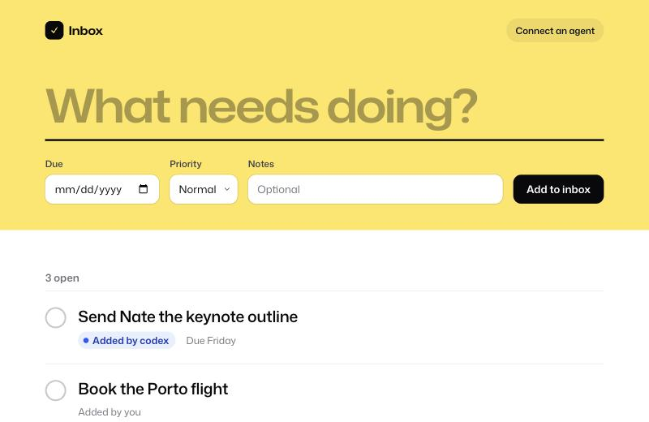

# Todo inbox

A todo inbox you can use from a web page and from AI agents. The page and the agents share one list. Agents connect over MCP (Model Context Protocol), and anything they add shows up on the page within a few seconds, marked with the agent's name.



## Tested with

Java 27, Spring Boot 4.0.9, Spring AI 2.0.1, jte 3.2.5.

## What you need

- JDK 27

## Run it

```bash
./mvnw spring-boot:run
```

Open http://localhost:8093. The inbox is saved to `todos.json` in the project folder.

## Try it

**On the web.** Type a title on the big line in the yellow band and press Enter. Click the circle to finish an item. Click a title to edit its notes, priority, or due date, or to delete it. Press `n` or `/` to jump back to the capture line.

**From Claude Code.** Add the server once:

```bash
claude mcp add --transport http todos http://localhost:8093/mcp
```

Then ask something like this:

```text
Add "Send Nate the keynote outline" to my todo inbox, due Friday.
```

The item appears on the open page, marked "Added by Claude Code". The page also shows the MCP address under "Connect an agent".

**Tools the agent gets.**

| Tool | What it does |
| --- | --- |
| `listTodos` | Lists open todos, or done ones |
| `addTodo` | Adds a todo with optional notes, priority, and due date |
| `updateTodo` | Changes only the fields you pass |
| `completeTodo` | Marks a todo done |
| `reopenTodo` | Moves a done todo back to open |
| `deleteTodo` | Deletes one todo |
| `clearDone` | Deletes every done todo |

## Where to look

- [TodoService.java](src/main/java/dev/danvega/todos/todo/TodoService.java) holds every action. Both sides call it.
- [TodoTools.java](src/main/java/dev/danvega/todos/mcp/TodoTools.java) turns those actions into MCP tools with `@McpTool`. The method name is the tool name.
- [InboxController.java](src/main/java/dev/danvega/todos/web/InboxController.java) serves the page and its form posts.

## Good to know

- Keep `spring.ai.mcp.server.protocol: streamable` in `application.yaml`. Spring AI 2.0.1 defaults to the older SSE transport, and then `/mcp` returns 404.
- The page polls `/api/version` every 2.5 seconds. That is how it picks up changes an agent makes.
- The "Added by" name comes from the `clientInfo` the MCP client sends when it connects.
- There is no login. Anyone who can reach port 8093 can read and change the inbox. Keep it on localhost.
- jte runs in development mode, so template edits show up on refresh.
